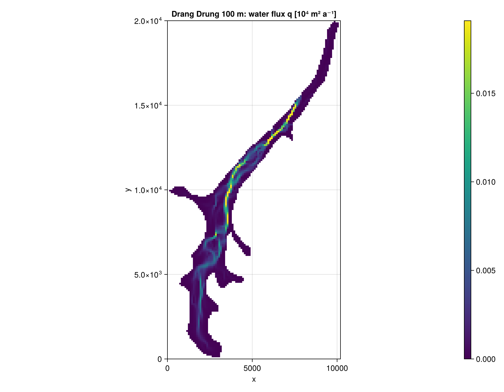
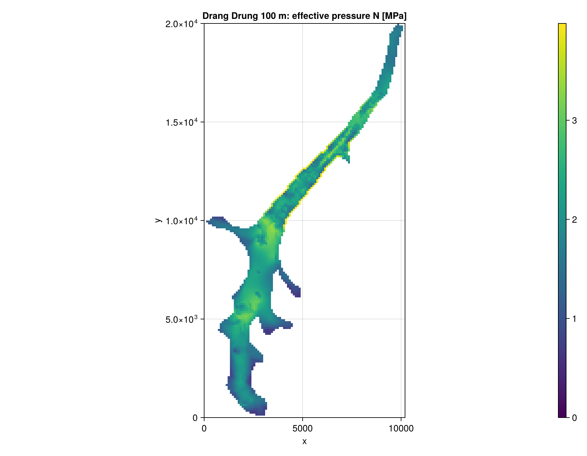
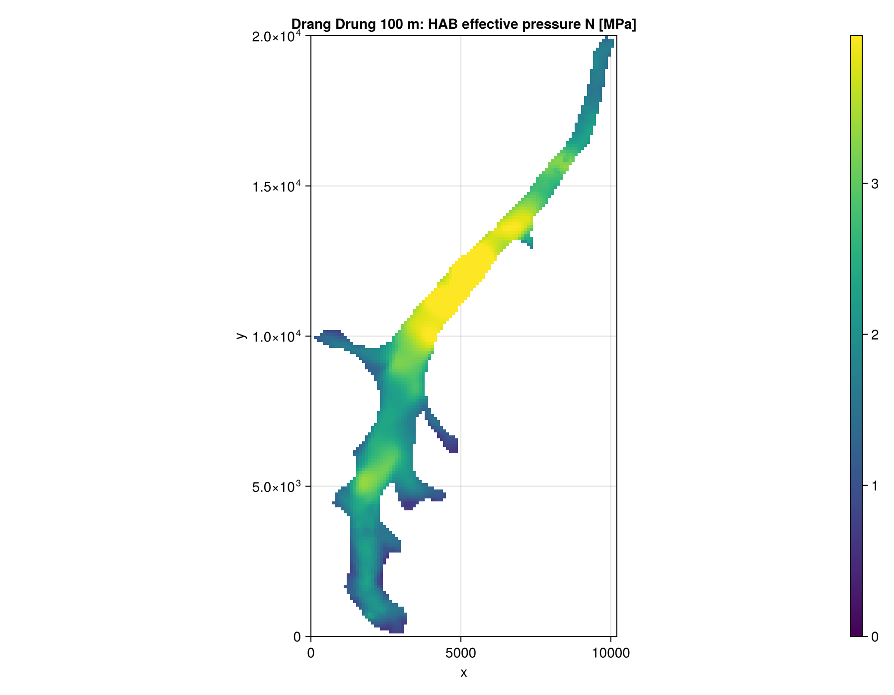
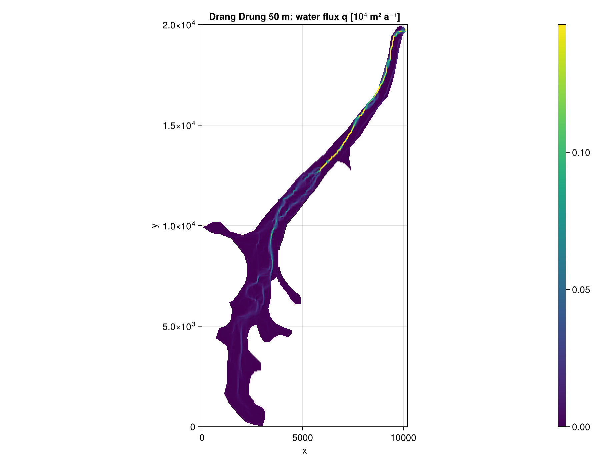
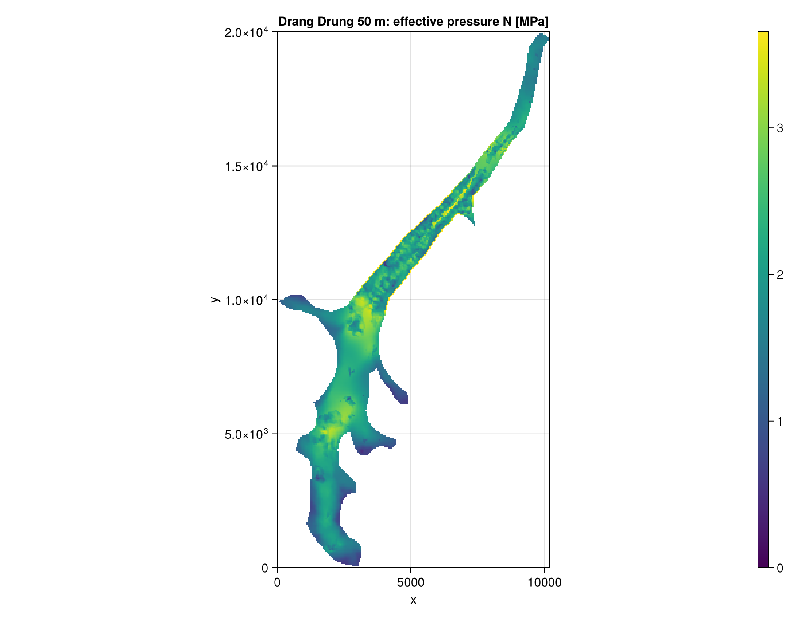
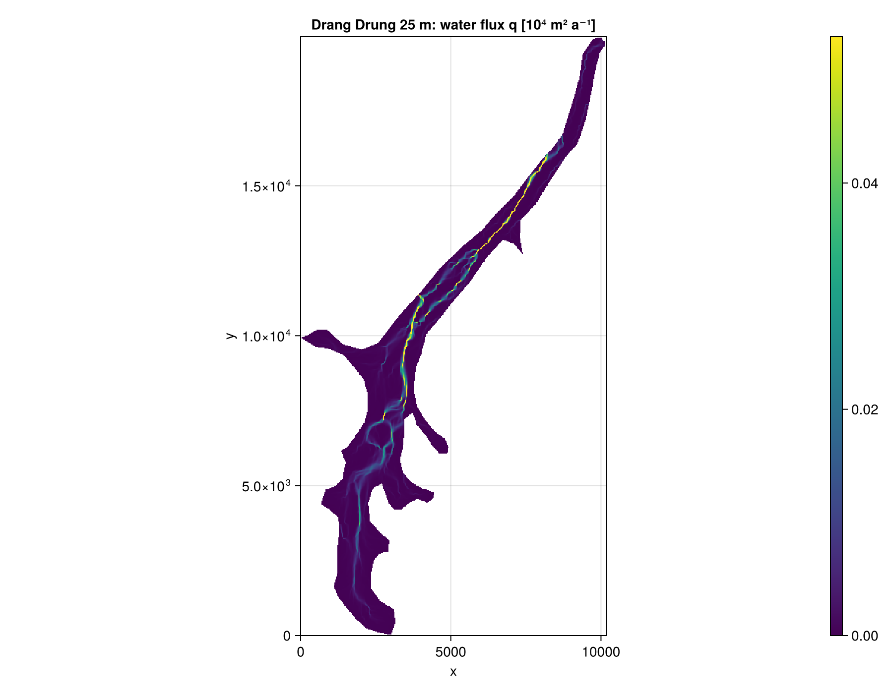
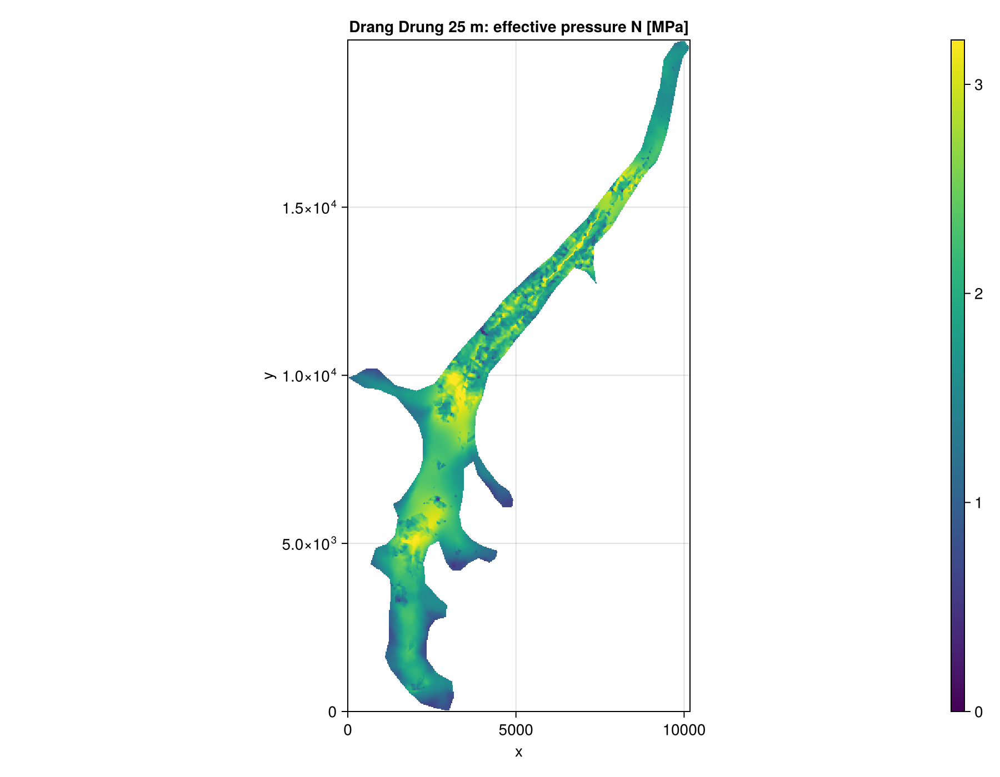
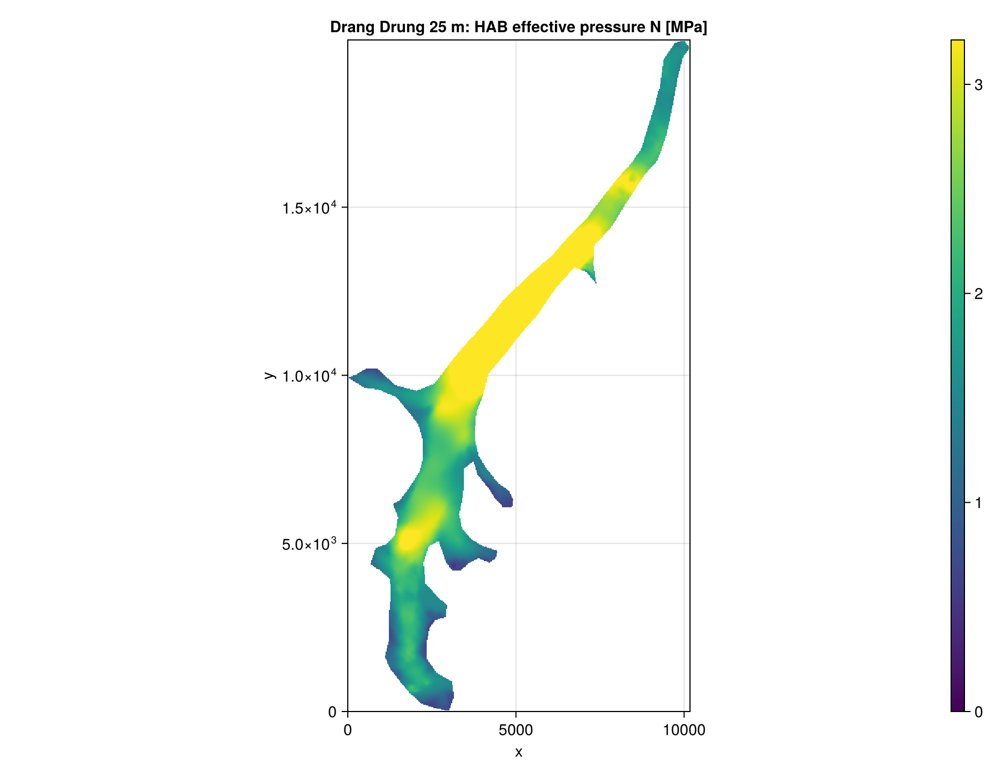

# Drang Drung

K24 and HAB on Drang Drung Glacier, at 100, 50 and 25 m. The inputs are the grids used by [Shakti.jl](https://github.com/TakisAngelides/Shakti.jl) (thickness, bed, flow rate factor, geothermal flux), with Shakti's mask (its frozen bed closed, its grounded cells without ice as land). The data has no velocity, so `abs_v_b = 0`, and the bed is hard with `q_T = 0`. The loader is `load_drangdrung` in `docs/make_figures.jl`. Default settings, `coupling_length_kamb86 = 0`.

```julia
using FastHydrology
import CairoMakie

# own arrays on a regular grid, SI units (see the Tutorial for what each one is)
Nx, Ny, xlims, ylims, mask, h, b, abs_v_b, A_visc, G, q_T, kappa = load_drangdrung(dx)

grid  = ArrayHydroGrid(Nx, Ny, xlims, ylims)
state = HydroState(grid, mask, h, b)

model = KazmierczakHydroModel(grid, kappa, abs_v_b, A_visc, G, q_T; coupling_length_kamb86 = 0.0)
run!(SteadyStateSimulation(model, grid, state))

state_hab = HydroState(grid, mask, h, b)
run!(SteadyStateSimulation(HABHydroModel(grid), grid, state_hab))

visualize_field(grid, mask_field(perSecond2perYear.(model.q) ./ 1e4, mask, NaN);
                plot_title = "q [10^4 m^2/a]", colormap = :viridis)
visualize_field(grid, mask_field(state.N ./ 1e6, mask, NaN);
                plot_title = "N [MPa]", colormap = :viridis)
visualize_field(grid, mask_field(state_hab.N ./ 1e6, mask, NaN);
                plot_title = "HAB N [MPa]", colormap = :viridis)
```

Figures: K24 `q`, K24 `N`, HAB `N`. Colour bars are linear, from 0 to the 99th percentile of the grounded cells.

| Run | Grid | Grounded cells | K24 solve |
|---|---|---|---|
| 100 m | 102 x 200 | 2 695 | 2.4 ms |
| 50 m | 204 x 400 | 10 797 | 8.8 ms |
| 25 m | 407 x 799 | 43 246 | 35.4 ms |

## 100 m







## 50 m






## 25 m






