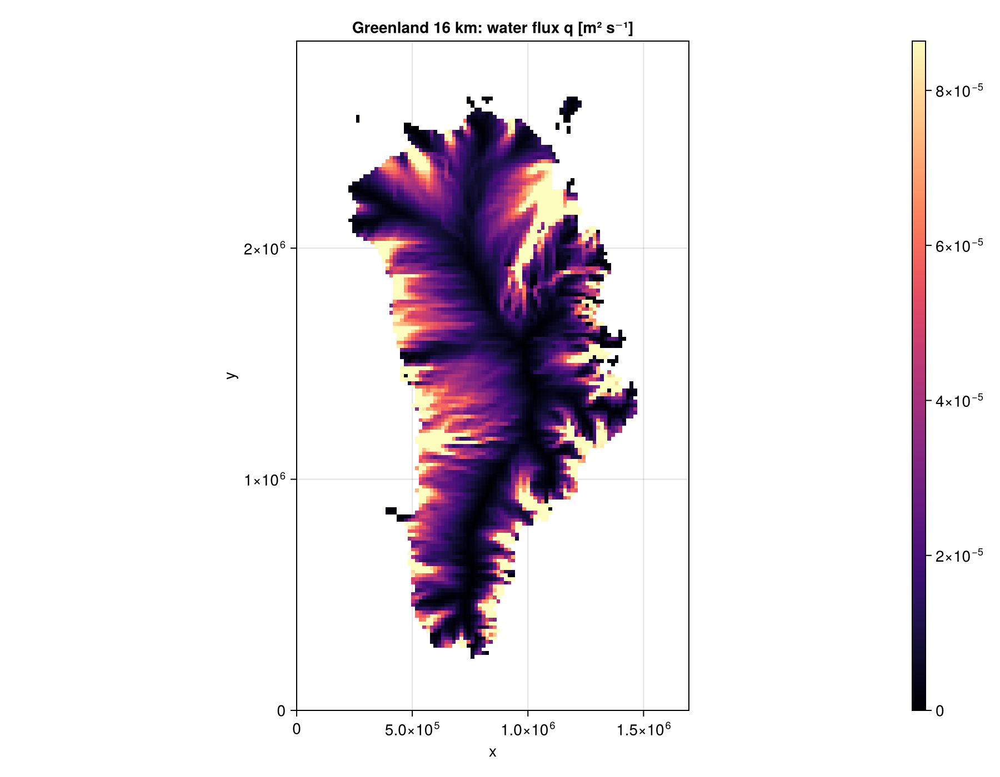
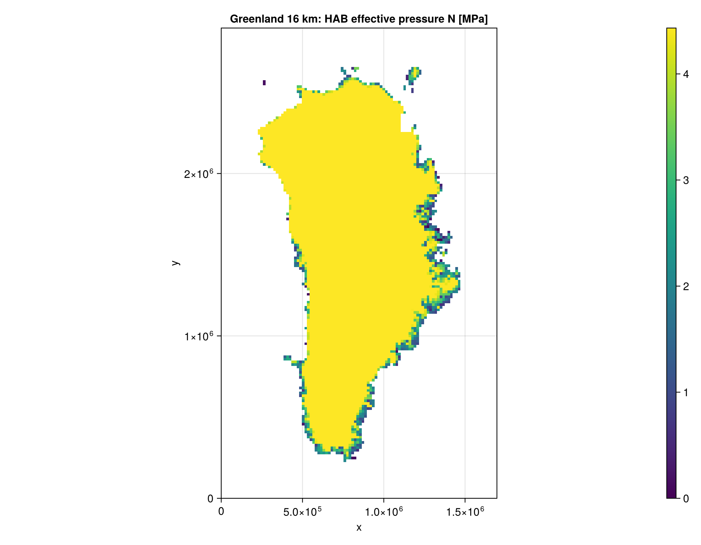
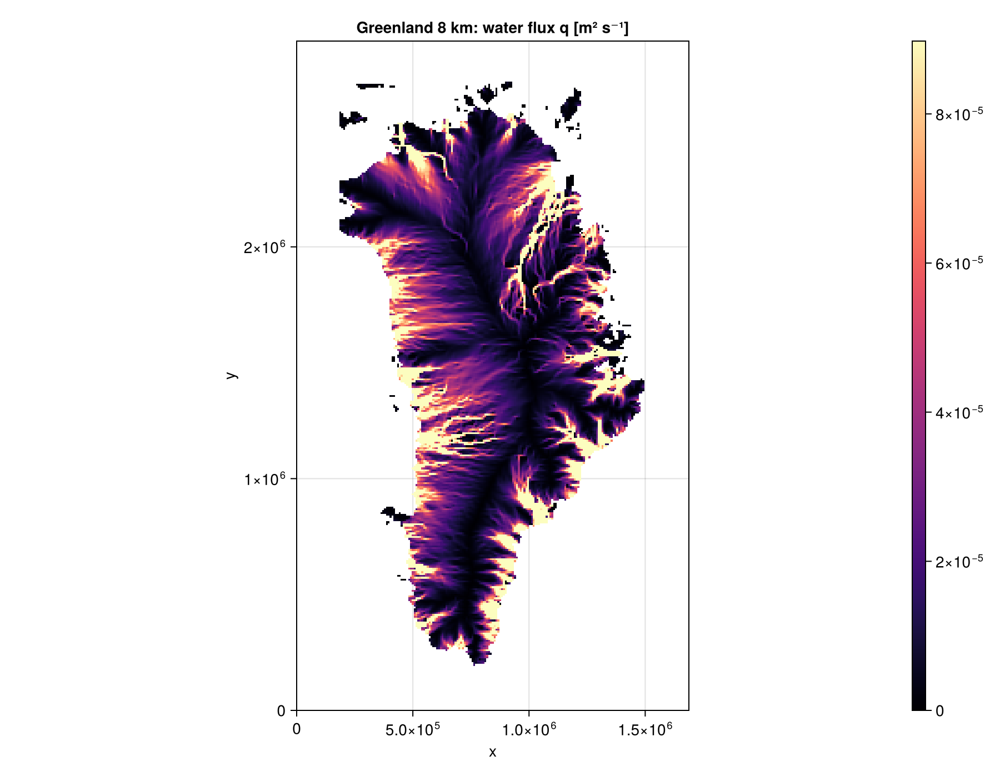
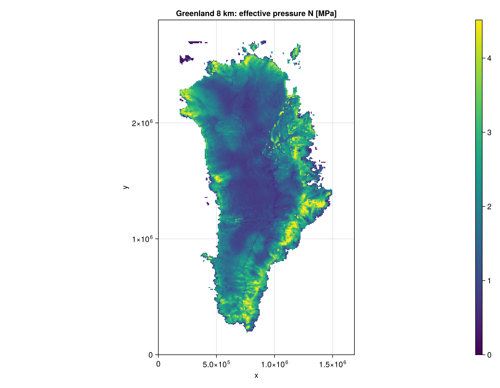
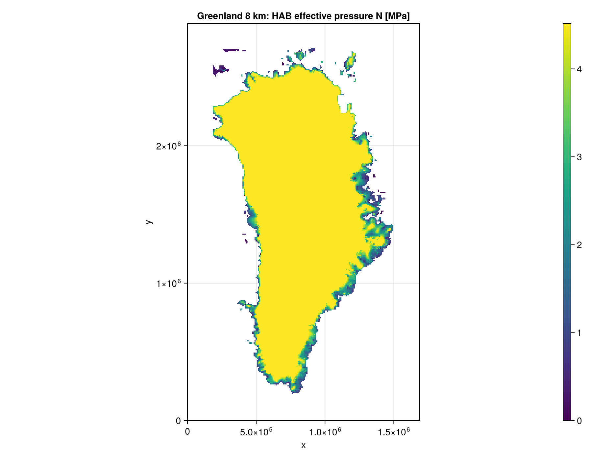
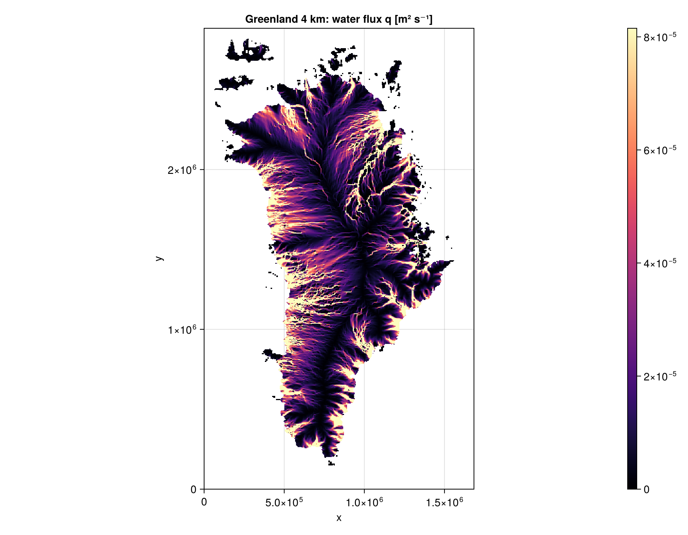
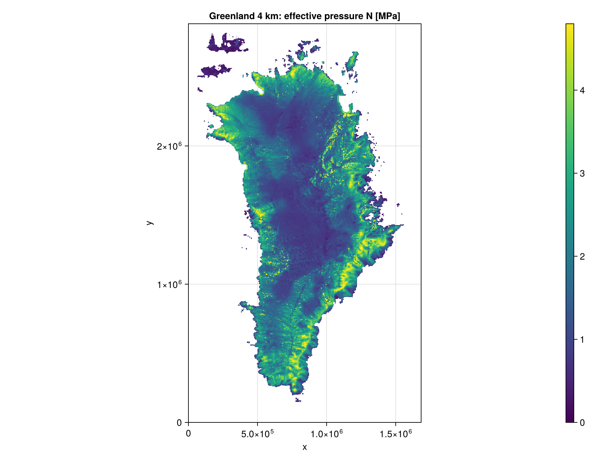
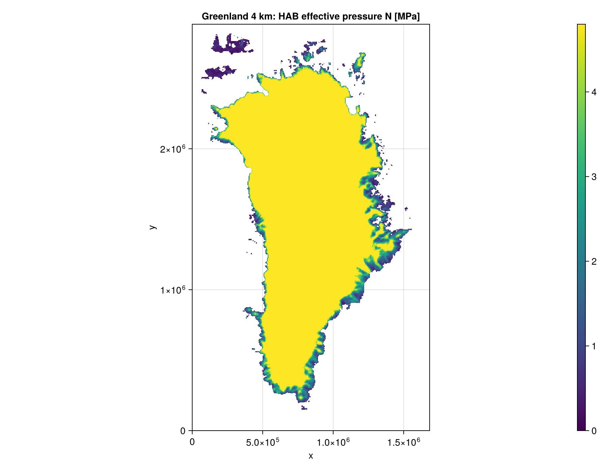

# Greenland

K24 and HAB on the Greenland Ice Sheet, from Yelmo(x) restart files at 16, 8 and 4 km. Same code as [Antarctica](@ref), only `path` changes. Default settings, `coupling_length_kamb86 = 0`, `bed_rheology = :mixed_smooth`. `q_T = 0` (Yelmo's `Q_ice_b` cancels the basal melt, so it is not used) and the friction heat comes from Yelmo's `tau_b`.
`max_psi_out_calls` is only raised because the 8 km (Antarctica) and 4 km (Greenland) runs have more grounded cells than its default of 100 000.

```julia
using FastHydrology
import CairoMakie
using Statistics: quantile

path = "yelmo_restart.nc"    # one file per resolution
Nx, Ny, xlims, ylims, mask, h, b, abs_v_b, A_visc, G, q_T, tau_b, kappa = load_yelmox(path)

grid  = ArrayHydroGrid(Nx, Ny, xlims, ylims)
state = HydroState(grid, mask, h, b)

# K24, default settings, no stress coupling, no q_T, friction heat from tau_b
model = KazmierczakHydroModel(grid, kappa, abs_v_b, A_visc, G, zero(q_T);
                              sliding_law = PrescribedFieldSlidingLaw(grid, tau_b),
                              coupling_length_kamb86 = 0.0,
                              max_psi_out_calls = 1_000_000)   # only needed above 100 000 grounded cells
run!(SteadyStateSimulation(model, grid, state))

# HAB
state_hab = HydroState(grid, mask, h, b)
run!(SteadyStateSimulation(HABHydroModel(grid), grid, state_hab))

q90 = quantile(model.q[mask .== GROUNDED], 0.9)
visualize_field(grid, mask_field(model.q, mask, NaN);
                plot_title = "q [m^2/s]", colormap = :magma, colorrange = (0.0, q90))
visualize_field(grid, mask_field(state.N ./ 1e6, mask, NaN);
                plot_title = "N [MPa]", colormap = :viridis)
visualize_field(grid, mask_field(state_hab.N ./ 1e6, mask, NaN);
                plot_title = "HAB N [MPa]", colormap = :viridis)
```

Figures: K24 `q`, K24 `N`, HAB `N`. Colour bars are linear and start at 0. `q` saturates at the 90th percentile of the grounded cells, `N` at the 99th.

| Run | Grid | Grounded cells | K24 solve |
|---|---|---|---|
| 16 km | 106 x 181 | 6 612 | 3.5 ms |
| 8 km | 211 x 361 | 27 601 | 13.8 ms |
| 4 km | 421 x 721 | 112 377 | 59.6 ms |

## 16 km






## 8 km







## 4 km






