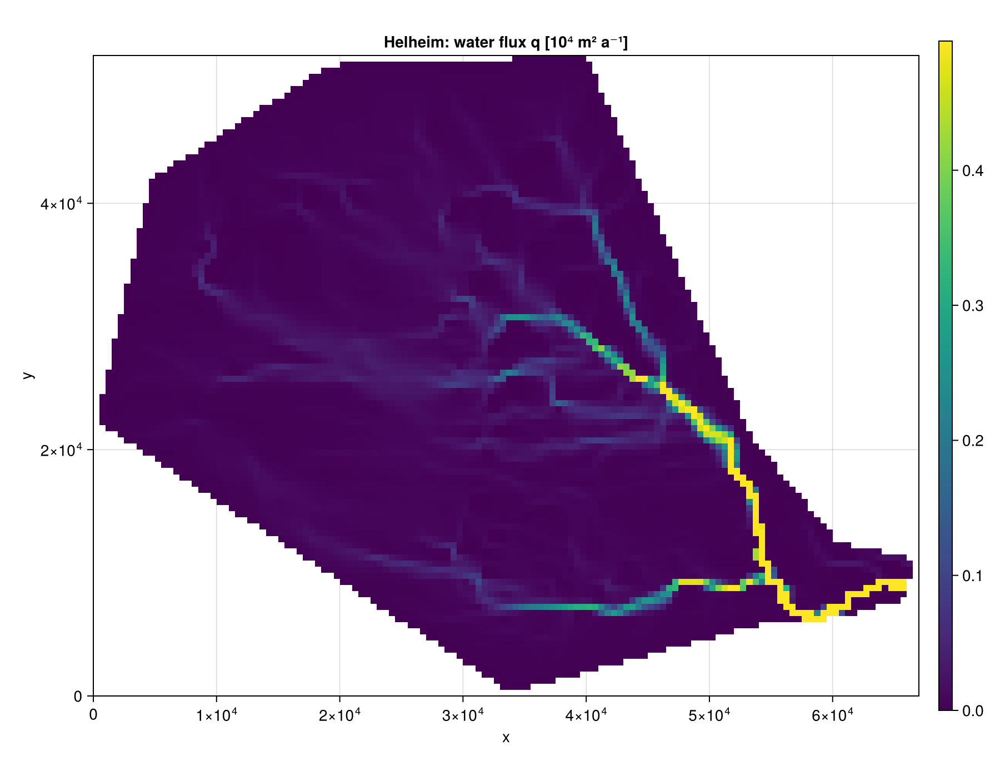
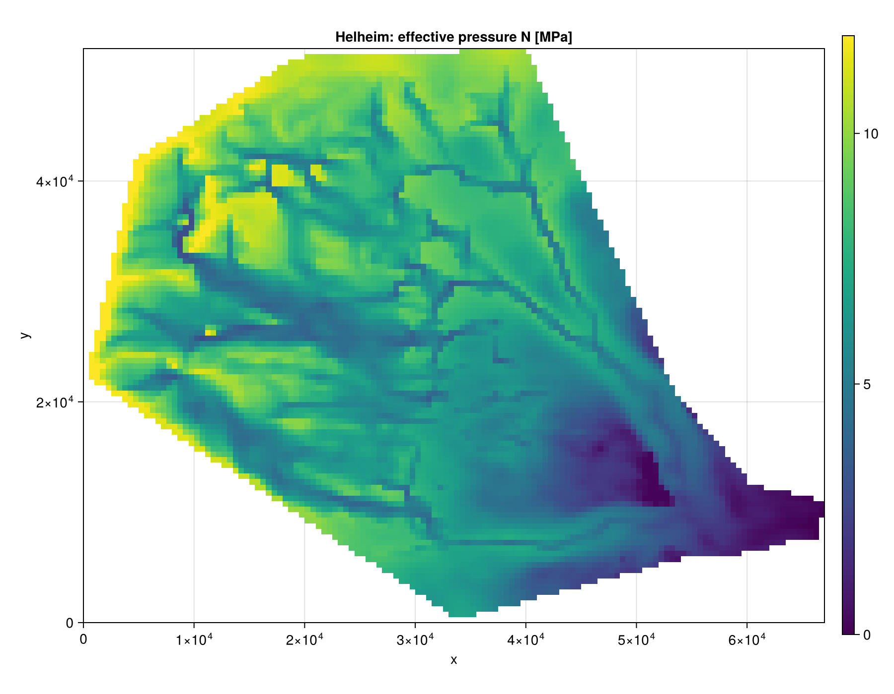
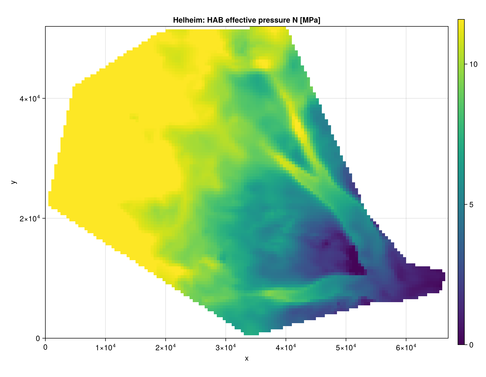

# Helheim

K24 and HAB on Helheim Glacier, 500 m grid. The input is the ISSM mesh of [Sommers et al.](https://doi.org/10.5281/zenodo.7019805) (the Shakti.jl Helheim example), interpolated onto a regular grid with Shakti's mask (water leaves only at the terminus, the rest of the mesh edge is closed), sliding speed from the ISSM velocity, hard bed, `q_T = 0`. The loader is `load_helheim` in `docs/make_figures.jl`. Default settings, `coupling_length_kamb86 = 0`.

```julia
using FastHydrology
import CairoMakie

# own arrays on a regular grid, SI units (see the Tutorial for what each one is)
Nx, Ny, xlims, ylims, mask, h, b, abs_v_b, A_visc, G, q_T, kappa = load_helheim()

grid  = ArrayHydroGrid(Nx, Ny, xlims, ylims)
state = HydroState(grid, mask, h, b)

model = KazmierczakHydroModel(grid, kappa, abs_v_b, A_visc, G, q_T; coupling_length_kamb86 = 0.0)
run!(SteadyStateSimulation(model, grid, state))

state_hab = HydroState(grid, mask, h, b)
run!(SteadyStateSimulation(HABHydroModel(grid), grid, state_hab))

visualize_field(grid, mask_field(perSecond2perYear.(model.q) ./ 1e4, mask, NaN);
                plot_title = "q [10^4 m^2/a]", colormap = :viridis)
visualize_field(grid, mask_field(state.N ./ 1e6, mask, NaN);
                plot_title = "N [MPa]", colormap = :viridis)
visualize_field(grid, mask_field(state_hab.N ./ 1e6, mask, NaN);
                plot_title = "HAB N [MPa]", colormap = :viridis)
```

Figures: K24 `q`, K24 `N`, HAB `N`. Colour bars are linear, from 0 to the 99th percentile of the grounded cells.

| Run | Grid | Grounded cells | K24 solve |
|---|---|---|---|
| 500 m | 134 x 104 | 8 207 | 3.9 ms |

## 500 m






