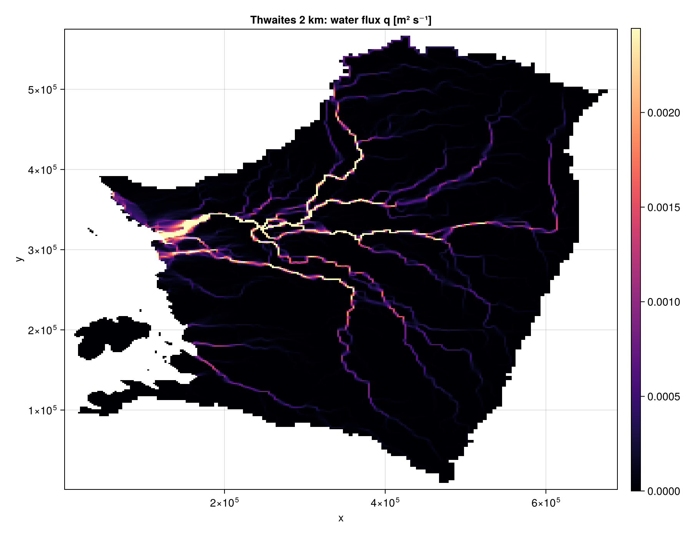
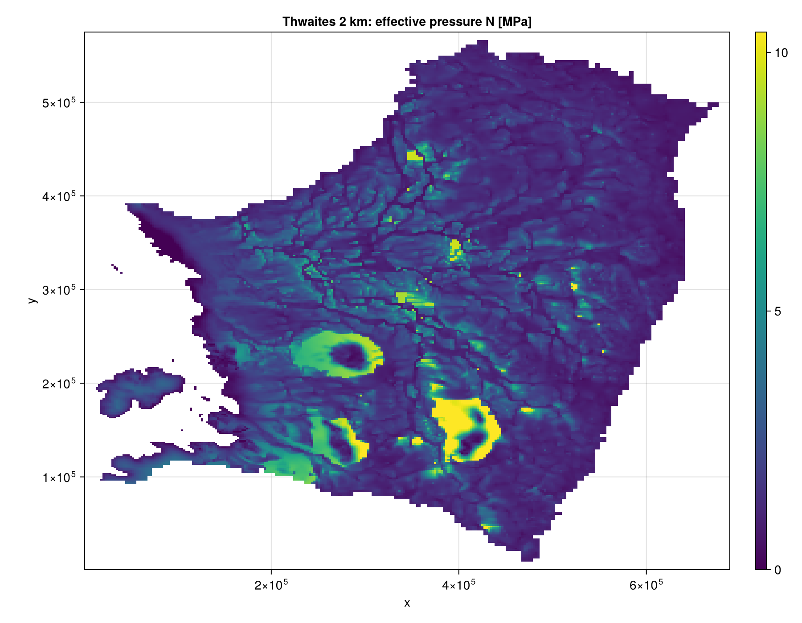
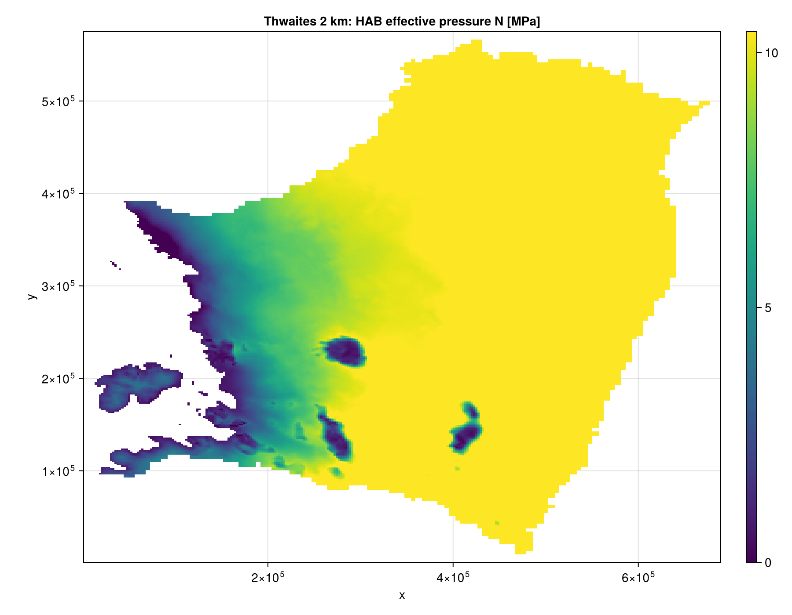
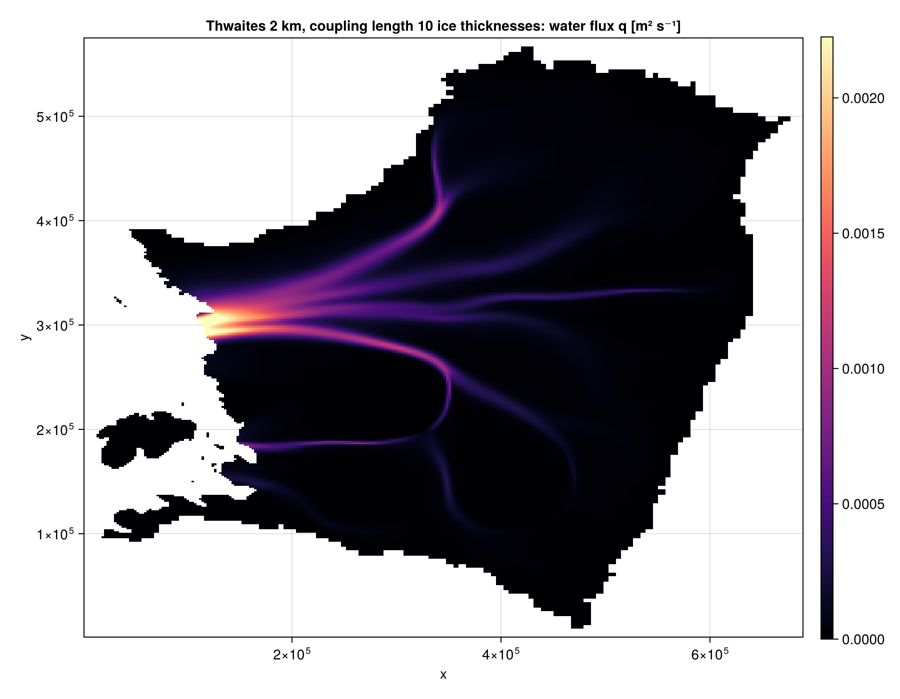

# Thwaites

K24 and HAB on Thwaites Glacier, 2 km grid, from the Kazmierczak et al. (2024) Kori-ULB output. Water leaves at the grounding line; the inland basin boundary is closed (`OTHER_BASIN`). Default settings, `coupling_length_kamb86 = 0`, `bed_rheology = :hard`. `q_T` is the conductive flux of the source model and the friction heat comes from its `tau_b`.

```julia
using FastHydrology
import CairoMakie
using Statistics: quantile

path = "THWAITES2km_m3_HAB_toto.mat"
Nx, Ny, xlims, ylims, mask, h, b, abs_v_b, A_visc, G, q_T, tau_b, kappa = load_Kazmierczak(path)

grid  = ArrayHydroGrid(Nx, Ny, xlims, ylims)
state = HydroState(grid, mask, h, b)

model = KazmierczakHydroModel(grid, kappa, abs_v_b, A_visc, G, q_T;
                              sliding_law = PrescribedFieldSlidingLaw(grid, tau_b),
                              coupling_length_kamb86 = 0.0)
run!(SteadyStateSimulation(model, grid, state))

state_hab = HydroState(grid, mask, h, b)
run!(SteadyStateSimulation(HABHydroModel(grid), grid, state_hab))

# x and y are swapped in the file, hence transpose_data
q99 = quantile(model.q[mask .== GROUNDED], 0.99)
visualize_field(grid, mask_field(model.q, mask, NaN);
                plot_title = "q [m^2/s]", colormap = :magma, colorrange = (0.0, q99), transpose_data = true)
visualize_field(grid, mask_field(state.N ./ 1e6, mask, NaN);
                plot_title = "N [MPa]", colormap = :viridis, transpose_data = true)
visualize_field(grid, mask_field(state_hab.N ./ 1e6, mask, NaN);
                plot_title = "HAB N [MPa]", colormap = :viridis, transpose_data = true)
```

Figures: K24 `q`, K24 `N`, HAB `N`. Colour bars are linear and start at 0, saturating at the 99th percentile of the grounded cells.

| Run | Grid | Grounded cells | K24 solve |
|---|---|---|---|
| 2 km | 345 x 288 | 51 945 | 23.3 ms |







## With stress coupling

`coupling_length_kamb86 = 10`: stress-gradient coupling length of 10 ice thicknesses (Kamb, 1986). This is the setting of Fig. S3d in the supplementary material of [Kazmierczak et al. (2024)](https://doi.org/10.5194/tc-18-5887-2024). The melt rate, routing and other details of the options here are not exactly those of the paper, so the map differs in detail. The code can reproduce that figure exactly with the matching options (for example `routing_scheme = GDSWarner()`, see the Tutorial).

```julia
model10 = KazmierczakHydroModel(grid, kappa, abs_v_b, A_visc, G, q_T;
                                sliding_law = PrescribedFieldSlidingLaw(grid, tau_b),
                                coupling_length_kamb86 = 10.0)
run!(SteadyStateSimulation(model10, grid, HydroState(grid, mask, h, b)))
```


